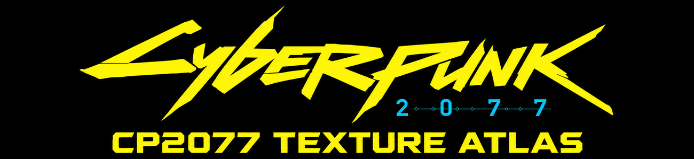
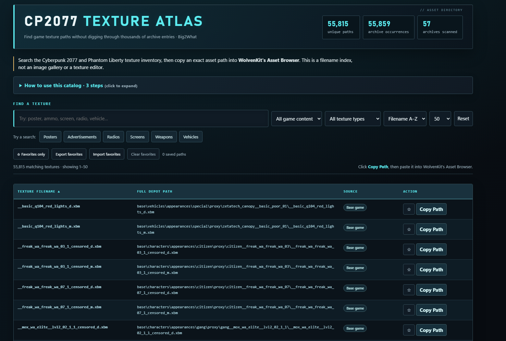

# CP2077 Texture Atlas

**An offline, searchable texture-path catalog for Cyberpunk 2077 and Phantom Liberty.**

---

**CP2077 Texture Atlas** helps modders find the internal depot paths of texture assets without manually searching through thousands of game archive entries. Search the catalog, narrow down the results, and copy an individual path into **WolvenKit's Asset Browser**.

The catalog was built from a supplied collection of Cyberpunk 2077 base-game and Phantom Liberty archives. It includes **55,815 unique `.xbm` texture paths**, representing **55,859 occurrences across 57 scanned archives**.

This is a **path index**, not a texture image gallery or editor. The texture images themselves are not included.

---

## Features

- Search texture filenames and full depot paths
- Quick searches for posters, advertisements, radios, screens, weapons, and vehicles
- Filter by base-game or Phantom Liberty content
- Filter by common texture filename suffixes
- Sort by path or filename and navigate paginated results
- Copy individual depot paths for use in WolvenKit
- Save frequently used paths as favorites
- Export and import favorites as JSON files
- Remember searches and filter preferences locally
- Keyboard shortcuts and accessible sorting controls
- Fully offline operation, with no catalog server required

---

## Screenshot

---

## Two Ways to Use the Atlas

### Standalone HTML

Open the Atlas HTML file in a modern browser, including Chrome or Brave. No installation, account, internet connection, game runtime, or mod framework is needed to browse the catalog.

### Electron — Windows Desktop

Run the Windows desktop edition in its own application window. It uses the same texture-path catalog and interface as the HTML edition.

The Electron source project is in [`src/`](src/), with additional desktop-edition instructions in [`doc/CP2077_Texture_Atlas_Electron_README.md`](doc/CP2077_Texture_Atlas_Electron_README.md).

The repository also includes a [project ZIP](zip/CP2077_TEXTURE_ATLAS_project.zip). This is **project source**, not a prebuilt Windows executable.

---

## Usage

1. **Search** for a texture by its name or a word in the path. Use filters to narrow the list.
2. Select **Copy Path** next to the texture you want.
3. Paste the path into **WolvenKit's Asset Browser**.

Use the star control to save favorites. Favorites can be exported to a JSON file and imported later, including when switching between browsers or editions. Only one depot path is copied at a time.

---

## What the Catalog Contains

| Inventory measure | Count |
| --- | ---: |
| Unique resolved `.xbm` paths | 55,815 |
| Archive occurrences, including duplicates | 55,859 |
| Archives scanned | 57 |
| Duplicate occurrences | 44 |

The supplied scan also contained **183 unresolved entries of unknown type**, which were excluded. The catalog does not claim to list every texture from every game version or installed mod.

---

## Requirements

**To browse:**

- HTML edition: a modern web browser
- Desktop edition: Windows and the built Electron application

**To inspect or modify the assets:**

- Cyberpunk 2077 / Phantom Liberty game archives, as applicable
- [WolvenKit](https://github.com/WolvenKit/WolvenKit)

Cyber Engine Tweaks, REDmod, and other in-game mod frameworks are **not required** to browse the Atlas.

---

## Project Files

| Location | Purpose |
| --- | --- |
| [`media/`](media/) | GitHub banner and interface screenshot |
| [`src/`](src/) | Atlas HTML and Electron desktop project source |
| [`doc/`](doc/) | Desktop-edition user documentation |
| [`zip/`](zip/) | Downloadable source project archive |

---

## Limitations and Data Handling

The Atlas indexes **file paths only**. It cannot display `.xbm` images directly, extract textures, or modify game archives. A search result is an indexed depot path, not a guarantee that a texture can be edited independently of its materials or other game assets.

The Atlas works offline. Favorites and preferences are stored locally in the environment running it; use the JSON export to keep a transferable backup. No texture data is sent to an Atlas server.

This is an independent, community-made utility and is **not affiliated with or endorsed by CD PROJEKT RED or the WolvenKit project**.

---

## Credits

**Project direction, testing, review, and release:** Big2What / Big2What-Mods  
**HTML interface and development assistance:** OpenAI ChatGPT, with human review and iterative browser testing

**Version 0.9.1**
